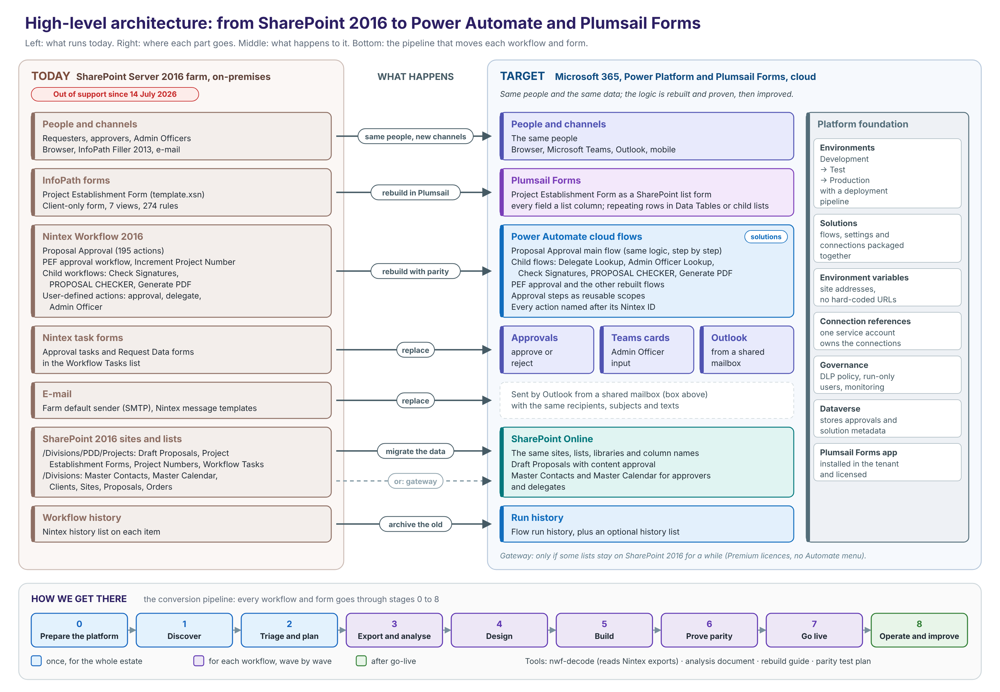
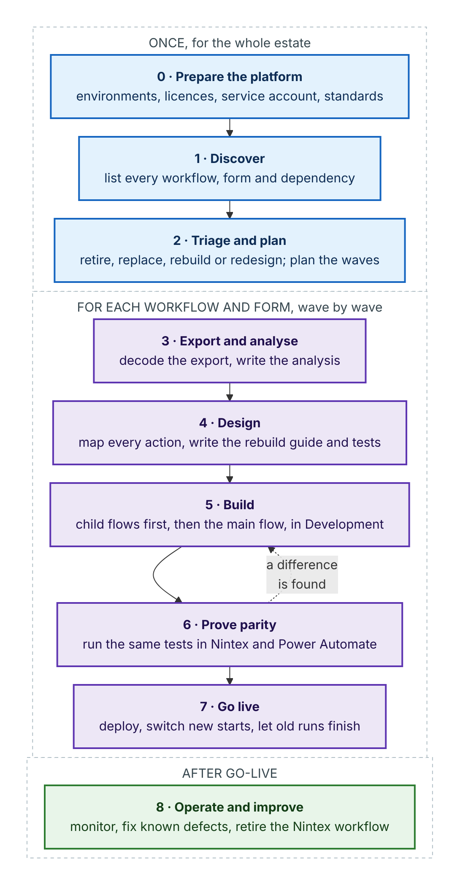
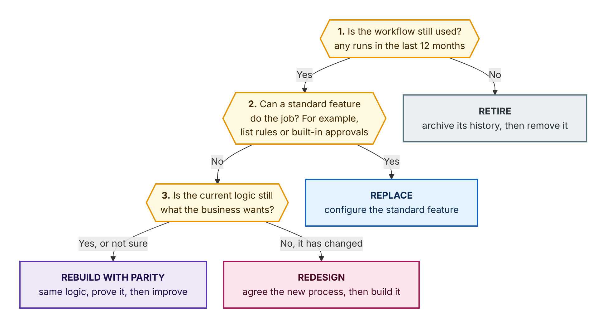

# Moving SharePoint 2016 workflows and forms to Power Automate and Plumsail Forms

**High-level plan and conversion pipeline** · Version 1.1 · October 2026

This document explains how we will move our SharePoint Server 2016 workflows (Nintex Workflow 2016 and SharePoint Designer) to Microsoft Power Automate, and our InfoPath forms to Plumsail Forms. It is written for everyone involved: managers who need the plan and the decisions, and builders who need the method.

Contents:

1. [Summary](#1-summary)
2. [Why we have to move](#2-why-we-have-to-move)
3. [Architecture: today and target](#3-architecture-today-and-target)
4. [Principles](#4-principles)
5. [The conversion pipeline](#5-the-conversion-pipeline)
6. [The stages in detail](#6-the-stages-in-detail)
7. [Triage and sizing](#7-triage-and-sizing)
8. [Phases and timeline](#8-phases-and-timeline)
9. [Roles and responsibilities](#9-roles-and-responsibilities)
10. [How the building blocks map to the target](#10-how-the-building-blocks-map-to-the-target)
11. [Main risks](#11-main-risks)
12. [Where we are now](#12-where-we-are-now)
13. [Checklist for each workflow](#13-checklist-for-each-workflow)
14. [Glossary](#14-glossary)
15. [Sources](#15-sources)

---

## 1. Summary

- **Why.** SharePoint Server 2016 and InfoPath 2013 have been out of Microsoft support since 14 July 2026. SharePoint Online no longer runs the older SharePoint 2013 workflows (since 2 April 2026), so our workflows cannot simply be moved to the cloud as they are. Our Nintex workflows depend on SharePoint 2016, so they have to be rebuilt.
- **Where to.** Power Automate cloud flows, with Approvals, Microsoft Teams and Outlook for the people steps. The InfoPath forms are rebuilt in **Plumsail Forms**, as SharePoint list forms whose fields are stored in list columns.
- **How.** Every workflow and every InfoPath form goes through the same nine-stage **conversion pipeline** (section 5). Stages 0 to 2 happen once for the whole estate. Stages 3 to 8 are repeated for each workflow and form, in waves.
- **Rebuild first, improve second.** We first rebuild each workflow with **exactly the same logic**, including its known defects, and prove it with side-by-side tests. Only then do we fix the defects and improve the process. This keeps every change visible and every result testable.
- **Pilot.** *Proposal Approval*, one of our largest Nintex workflows (195 actions), is the pilot. Its analysis and a complete step-by-step rebuild guide are already done (section 12).
- **Decisions needed now:**
  1. the target for the SharePoint data (SharePoint Online, or SharePoint 2016 behind a gateway);
  2. the Power Platform environments and licences, and the Plumsail Forms licence;
  3. a service account and a shared mailbox for the flows;
  4. a business owner for each workflow;
  5. getting the missing Nintex exports (user-defined actions and child workflows).

---

## 2. Why we have to move

| Date | What happened | What it means for us |
|---|---|---|
| 2 April 2026 | SharePoint 2013 workflows stopped running in SharePoint Online | Workflows cannot be moved to the cloud as they are. They must be rebuilt, in Power Automate |
| 14 July 2026 | Extended support ended for SharePoint Server 2016 and 2019 | No more security fixes for the platform our workflows run on |
| 14 July 2026 | Support ended for the InfoPath 2013 client | The forms our workflows start from (for example the Project Establishment Form) must be replaced. We will rebuild them in Plumsail Forms |
| No date announced | Nintex Workflow for SharePoint 2016 | Nintex has not announced an end date, but the product runs only on SharePoint 2016, which is no longer supported |

Running unsupported software is a growing security and operational risk. The sooner the workflows are moved, the sooner SharePoint 2016 can be switched off.

---

## 3. Architecture: today and target

*Left: what runs today on SharePoint Server 2016. Right: where each part goes in Microsoft 365, the Power Platform and Plumsail Forms. Middle: what happens to each part. Bottom: the conversion pipeline (section 5) that moves each workflow and form.*

| Today (SharePoint 2016) | What happens | Target (Microsoft 365, Power Platform and Plumsail Forms) |
|---|---|---|
| People work in the browser, InfoPath Filler 2013 and e-mail | Same people, new channels | Browser, Microsoft Teams, Outlook and mobile |
| InfoPath forms, such as the Project Establishment Form | Rebuild in Plumsail Forms | Plumsail Forms: SharePoint list forms with the same sections, rules and roles; every field is a list column |
| Nintex Workflow 2016 workflows, child workflows and user-defined actions | Rebuild with parity | Power Automate cloud flows and child flows, packaged in solutions |
| Nintex task forms in the Workflow Tasks list | Replace | Approvals for approve or reject; Teams adaptive cards for data entry |
| E-mail from the farm's default sender | Replace | Outlook, sent from a shared mailbox |
| SharePoint 2016 sites and lists | Migrate the data | SharePoint Online, with the same names and columns. A gateway is the alternative while some lists stay on SharePoint 2016 |
| Nintex workflow history | Archive | Flow run history, plus an optional history list |

**Platform foundation.** Everything on the target side sits on a common foundation:

- three environments (Development → Test → Production) with a deployment pipeline;
- solutions that package the flows with their settings;
- environment variables for the site addresses, so no address is hard-coded;
- connection references owned by one service account;
- governance: a data-loss-prevention policy, run-only users and monitoring;
- Dataverse, which stores the approvals and the solution data;
- the Plumsail Forms app, installed in the tenant and licensed, for the forms.

## 4. Principles

1. **Same logic first.** Each workflow is rebuilt to behave exactly as it does today. Known defects are copied on purpose and marked, so nothing changes without a decision.
2. **Prove it.** A workflow goes live only when the same test scenarios give the same results in Nintex and in Power Automate. A form goes live only when the same test data gives the same results in InfoPath and in Plumsail Forms.
3. **Improve after go-live.** Defects and improvements are handled as normal, tested changes once the rebuild is live.
4. **One pipeline for every workflow.** The same stages, templates and checklists every time, so the work is predictable and can be shared between people.
5. **Everything in solutions.** Flows, environment variables and connections live in Power Platform solutions, built in Development and moved to Test and Production as managed solutions. Plumsail forms are the exception: each form is exported from the Plumsail designer, kept in this repository and imported into the Test and Production sites.
6. **Document as we go.** Every analysis, rebuild guide and test result is kept in this repository, so knowledge does not depend on one person.

---

## 5. The conversion pipeline

*Stages 0–2 run once for the whole estate. Stages 3–7 run for each workflow and form, wave by wave. If the parity test finds a difference, the workflow goes back to Build. Stage 8 runs after go-live.*

| Stage | Purpose | Main output | Done when |
|---|---|---|---|
| **0 · Prepare the platform** | Get the target ready | Environments, licences, service account, standards | A test flow can read and write the target lists, and a test Plumsail form saves to a list |
| **1 · Discover** | Know what we have | Inventory of every workflow, form and dependency | Every workflow has an owner, usage figures and a size |
| **2 · Triage and plan** | Decide what happens to each workflow | Retire / replace / rebuild / redesign decision; wave plan | The sponsor has approved the wave plan |
| **3 · Export and analyse** | Understand one workflow completely | Decoded export and analysis document | The process owner agrees the analysis is right |
| **4 · Design** | Decide how to build it | Rebuild guide with an action map and test plan | Every Nintex action has a Power Automate step |
| **5 · Build** | Build it | Child flows and main flow in a solution in Development | Every step in the guide is built and reviewed |
| **6 · Prove parity** | Show it behaves the same | Signed-off parity test results | All test scenarios match, apart from documented deviations |
| **7 · Go live** | Switch over safely | Managed solution in Production; Nintex start disabled | New requests run in Power Automate; old ones finish in Nintex |
| **8 · Operate and improve** | Keep it healthy, then make it better | Monitoring, defect fixes, retired Nintex workflow | The Nintex workflow is removed and its history archived |

---

## 6. The stages in detail

### Stage 0 · Prepare the platform (once)

**Goal.** A ready, governed place to build and run the flows.

**What we do:**

- **Decide where the SharePoint data will live.** The recommended target is **SharePoint Online**. If some lists must stay on SharePoint 2016 for a while, Power Automate can reach them through an **on-premises data gateway**, which needs Premium licences.
- **Create three Power Platform environments:** Development, Test and Production. Set up a deployment pipeline between them.
- **Agree licences.** Standard Microsoft 365 licences cover the SharePoint, Outlook, Teams and Approvals connectors. The gateway or premium connectors need Power Automate Premium.
- **Buy and install Plumsail Forms** for SharePoint Online, and give the form designers access to its designer.
  - Plumsail Forms runs on SharePoint Online and on SharePoint 2019 or Subscription Edition, not on SharePoint 2016. The list behind each form must therefore be in SharePoint Online, even if the gateway is used for other lists.
  - Each Plumsail form belongs to a SharePoint list, so create Development and Test SharePoint sites as well. Forms move between sites by exporting and importing them in the designer; the target list must have the same columns.
- **Create a service account** that owns the connections, and a **shared mailbox** that sends the e-mails.
- **Set up governance:** a data-loss-prevention (DLP) policy, naming rules, and who may create flows in which environment.
- **Agree the building standards:** the patterns in the [rebuild guide](../powerautomate/proposal-approval-flow/README.md#reusable-patterns) (refresh item, set field, query, log, approval request) become our team standard.

**Output.** Environments, licences, accounts and standards are ready.

**Done when** a test flow in Production can read and write a target list as the service account, and a test Plumsail form saves to a list.

### Stage 1 · Discover (once)

**Goal.** A complete list of what we have to move.

**What we do:**

- **List every workflow** on every SharePoint 2016 site: Nintex workflows, SharePoint Designer 2010 and 2013 workflows, and out-of-the-box workflows. Microsoft's *SharePoint Migration Assessment Tool* (SMAT) and Nintex's own reports can help.
- **For each workflow, record:**
  - the site and list it runs on;
  - how it starts (by hand, on create, on change);
  - how often it ran in the last 12 months;
  - the business owner.
- **List the dependencies:** user-defined actions (UDAs), child workflows, task forms, InfoPath forms, other lists it reads, web services and hard-coded addresses.
- **List every InfoPath form:** the library it saves to, how many completed forms it holds, its views, rules and data connections, and the workflows it starts.
- **Run the decoder on each Nintex export** to get these facts automatically:
  `python3 tools/nwf-decode/nwf_decode.py --summary <workflow>.nwf`.

**Output.** An inventory with one row per workflow and one row per InfoPath form, with usage, owner, dependencies and size.

**Done when** every workflow in the inventory has an owner, usage figures and a size.

### Stage 2 · Triage and plan (once)

**Goal.** A decision for every workflow and a realistic order of work.

**What we do:**

- **Decide the fate of each workflow and each InfoPath form** with the [triage tree](#7-triage-and-sizing): **retire**, **replace** with a standard feature, **rebuild with parity**, or **redesign**.
- **Size it:** small, medium or large (section 7).
- **Group the workflows into waves** of similar size and shared dependencies. Workflows that share a user-defined action or a list go in the same wave, so the shared parts are built once.
- **Order the waves** by business importance and risk. Workflows on sites with the most sensitive data, or that stop the business when they fail, go first. A form and the workflows it starts move in the same wave.
- **Decide what happens to the completed InfoPath forms** (the saved XML files): convert them to list items for Plumsail Forms, or keep them read-only as an archive. Forms that are still in use, such as Project Establishment Forms for projects that can still be extended or closed, must be converted.

**Output.** The decision list and the wave plan.

**Done when** the sponsor approves the wave plan.

### Stage 3 · Export and analyse (each workflow)

**Goal.** Understand one workflow completely before changing anything.

**What we do:**

1. **Export everything** from Nintex: the workflow (`.nwf`), every user-defined action it calls (*Site Settings → Manage User Defined Actions → Export*), every child workflow it starts, its forms, and the list schemas.
2. **Decode the export** with `tools/nwf-decode/nwf_decode.py`. It numbers every action (A001, A002, …), so that the analysis, the design, the build and the tests all refer to the same IDs.
3. **Write the analysis document:**
   - what the workflow does;
   - a flow diagram;
   - a decision table (who approves in which case);
   - what it writes to the item;
   - the e-mails it sends;
   - a list of defects and risks.
4. **Review it with the process owner.**

For an **InfoPath form**, unpack the `.xsn` file (it is a cabinet archive) and analyse its views, fields, repeating sections, rules and data connections in the same way.

**Examples.** [docs/template-xsn.md](template-xsn.md) analyses the Project Establishment Form. [docs/proposal-approval-nwf.md](proposal-approval-nwf.md) analyses all 195 actions of *Proposal Approval* and lists 46 issues.

**Done when** the process owner agrees that the analysis describes the process as it works today.

### Stage 4 · Design (each workflow)

**Goal.** A build plan that someone else could follow.

**What we do:**

- **Map every Nintex action** to a Power Automate step, using the [cheat sheet](#10-how-the-building-blocks-map-to-the-target) and the standard patterns.
- **Decide the people steps:**
  - approvals become **Approvals**;
  - data-entry tasks become **Teams adaptive cards**;
  - InfoPath forms become **Plumsail Forms**.
- **Design each Plumsail form:** the list columns behind it, the layout (tabs instead of views), how each repeating section is stored, and how each rule is rebuilt. See [InfoPath forms to Plumsail Forms](#infopath-forms-to-plumsail-forms).
- **Decide what becomes a child flow.** Lookups become short child flows. Long human steps stay inline, because a child flow must answer its caller within 120 seconds.
- **List the deviations**, meaning where Power Automate cannot behave identically. Examples: the 30-day run limit, a different e-mail sender, Teams instead of task forms.
- **Mark every copied defect** with a parity note.
- **Write the parity test plan:** scenarios with the expected approvers, status texts, column values and e-mails.

**Example.** [powerautomate/proposal-approval-flow/README.md](../powerautomate/proposal-approval-flow/README.md) has a step for every one of the 195 actions, 21 deviations and 26 test scenarios.

**Done when** every Nintex action has a step in the action map, and the test plan is agreed.

### Stage 5 · Build (each workflow)

**Goal.** A working flow in the Development environment.

**What we do:**

- **Build inside a solution:** first the environment variables and connection references, then the child flows, then the main flow, stage by stage.
- **Name every action after its Nintex ID** (for example *A055 Supervisor's Approval*), so it can be traced back to the analysis.
- **Build each form** in the Plumsail designer on the list in the Development site. Export its definition from the designer and keep it in this repository.
- **Have a second builder review** the flow against the action map.

**Done when** every step in the guide is built and the review is complete.

### Stage 6 · Prove parity (each workflow)

**Goal.** Evidence that the new flow behaves like the old workflow.

**What we do:**

- **Set up a test site** with copies of the lists. Point the Test environment at it.
- **Run every scenario** from the test plan in Nintex and in Power Automate, with the same test users giving the same answers.
- **Compare the results:** who was asked to approve, the status texts, the column values, the approval status and the e-mails.
- **For forms:** enter the same test data in the InfoPath form and in the Plumsail form, and compare the saved values, totals, rules and validation messages.
- **Send any unexplained difference back to Build.** Differences that cannot be avoided must already be listed as deviations.
- **Get sign-off** from the process owner.

**Done when** all scenarios match, apart from documented deviations, and the process owner signs off.

### Stage 7 · Go live (each workflow)

**Goal.** A safe switch with nothing lost.

**What we do:**

- **Deploy** the managed solution to Production. Set the environment variables, connections and run-only users. Import each Plumsail form into its list in the Production site.
- **Tell users** what changes for them: where to start the flow, how approvals now arrive, and the new e-mail sender.
- **Switch:** new requests start in Power Automate, and the Nintex start option is removed. For a form, new requests use the Plumsail form. The InfoPath library becomes read-only once its running approvals have finished and the forms still in use have been converted.
- **Let running Nintex instances finish.** Do not cancel them.
  - If the lists move to SharePoint Online at the same time, agree a short freeze. During the freeze no new requests start, the open ones finish, and then the data moves.
  - Requests still open at the end of the freeze are restarted in Power Automate.
- **Watch the first runs closely.**

**Done when** new requests run in Power Automate and no request is left without an owner.

### Stage 8 · Operate and improve (each workflow)

**Goal.** A healthy flow, then a better one.

**What we do:**

- **Monitor** failed runs and runs older than about 20 days (a Power Automate run stops after 30 days). Agree who responds.
- **Fix the defects copied in Stage 4,** one change at a time, each with its own test. For *Proposal Approval* the first two are:
  - managers skipping higher approval (issue I01);
  - a GM approval overriding a rejection (issue I02).
- **When all open Nintex instances have finished:**
  - export and archive the Nintex workflow history;
  - remove the Nintex workflow;
  - record the workflow as done in the inventory.

**Done when** the Nintex workflow is removed and its history is archived.

---

## 7. Triage and sizing

### Deciding what happens to each workflow

*Answer the three questions in order. "Not sure" at question 3 means rebuild with parity: it is safer to copy the current behaviour and improve it later than to change it without evidence.*

| Decision | When | What we do |
|---|---|---|
| **Retire** | No runs in the last 12 months, or the process no longer exists | Archive the history, tell the owner, remove the workflow |
| **Replace** | A standard feature does the job, for example a list rule, an alert, or the built-in approval on a document library | Configure the feature; no flow to build |
| **Rebuild with parity** | The workflow is used and the logic is still right, or nobody is sure | Run stages 3–8 as described |
| **Redesign** | The business process has changed | Agree the new process first, then build it; test against the new process instead of the old workflow |

Use the same tree for each InfoPath form. A form counts as used if it was filled in during the last 12 months. For a form, *rebuild* and *redesign* both mean building it in Plumsail Forms.

### Sizing

The decoder's `--summary` output suggests a size. Adjust it with the owner's knowledge of the process.

| Size | Typical workflow | Planning effort, stages 3–7 |
|---|---|---|
| **Small** | Up to about 40 actions; no tasks; no user-defined actions or child workflows. For example, a notification workflow | 2–5 days |
| **Medium** | 40–120 actions; or approval or data-entry tasks; or one child workflow | 2–3 weeks |
| **Large** | More than 120 actions; or user-defined actions; or several child workflows and task forms. *Proposal Approval* is Large: 195 actions, 3 user-defined actions, 3 child workflows and 2 task forms | 4–8 weeks |

These efforts are **planning assumptions**. We replace them with real figures after the pilot. The elapsed time is usually longer than the effort, because testing depends on business users' time.

This table sizes workflows only. Size each InfoPath form with the form designer, based on its views, rules, repeating sections and data connections. We will add form sizes once the Project Establishment Form has been rebuilt.

---

## 8. Phases and timeline

The timeline is in weeks from the start of the programme. Phases overlap on purpose.

| Phase | Weeks | What happens | Result |
|---|---|---|---|
| **1. Foundation and discovery** | 1–4 | Stages 0, 1 and 2 | Platform ready; inventory; approved wave plan |
| **2. Pilot: Proposal Approval** | 3–12 | Stages 3–8 for the pilot; stages 3 and 4 are already done | First flow live; measured effort; templates and checklists confirmed |
| **3. Wave 1: Project Establishment Form** | 10–20 | The InfoPath form, rebuilt in Plumsail Forms, and its Nintex approval workflow, rebuilt in Power Automate; plus other high-priority workflows | The PEF process runs on Plumsail Forms and Power Automate |
| **4. Further waves** | from week 18, every 6–8 weeks | 3–6 workflows per wave, depending on size | Workflows move wave by wave |
| **5. Decommission** | after the last wave, about 4 weeks | Archive histories and any InfoPath forms that were not converted; remove Nintex; set SharePoint 2016 to read-only, then switch it off | SharePoint 2016 retired |

The length of phase 4 depends on the size of the inventory from stage 1. We will set real dates once the inventory and the pilot's effort are known.

---

## 9. Roles and responsibilities

| Role | Responsibilities |
|---|---|
| **Sponsor** | Sets priorities; approves the wave plan and every *retire* or *redesign* decision; removes blockers |
| **Process owner** (one per workflow, from the business) | Explains the process; confirms the analysis; supplies test users; signs off the parity test; decides on improvements |
| **Power Platform administrator** | Environments, licences, DLP policy, service account, connections, deployment pipeline, monitoring |
| **SharePoint administrator** | Inventory; Nintex exports (workflows, user-defined actions, child workflows); list migration; permissions; installing Plumsail Forms |
| **Flow developer** | Stages 3–5: analysis, design, build; fixes found in testing |
| **Form designer** (Plumsail) | Rebuilds each InfoPath form in Plumsail Forms: list columns, layout, repeating sections, rules and JavaScript |
| **Reviewer** (a second developer) | Checks each build against its action map |
| **Testers** (business users) | Run the parity scenarios in both systems |
| **Support** | First response to failed runs after go-live |

---

## 10. How the building blocks map to the target

### Nintex workflows to Power Automate

| Nintex | Power Automate |
|---|---|
| Workflow started by hand from the item menu | Instant flow with the *For a selected file* or *For a selected item* trigger |
| Workflow started when an item is created or changed | *When an item is created* or *When an item or file is modified* trigger |
| Workflow variables | *Initialize variable* actions at the top of the flow |
| Action set | Scope |
| Set a condition / Run if | Condition |
| Query list | SharePoint *Get items* with a filter |
| Set field / Update item | SharePoint *Update item*, or an HTTP request that updates only the named columns |
| Build string, Set variable | *Compose*, *Set variable* |
| Send notification | Outlook *Send an email (V2)*, from a shared mailbox |
| Request approval / user-defined approval action | Approvals *Start and wait for an approval* |
| Request data (task form) | Teams *Post adaptive card and wait for a response* |
| Start workflow (child workflow) | *Run a Child Flow*; long-running children answer at once and report completion later |
| User-defined action (UDA) | A child flow, or a copied scope when it waits for people |
| Set approval status | SharePoint *Set content approval status* |
| Wait for check-out status | *Do until* loop with a delay |
| Log in history list | Run history, plus an optional history list |
| Commit pending changes | Not needed: Power Automate writes immediately |
| End workflow | *Terminate* |

The [rebuild guide](../powerautomate/proposal-approval-flow/README.md) shows every one of these in detail, with exact expressions.

### InfoPath forms to Plumsail Forms

Plumsail Forms replaces the standard SharePoint list forms with forms designed in its own designer. The biggest change is where the data lives: InfoPath saved each form as an XML file, while a Plumsail form saves its fields as columns of a SharePoint list item.

| InfoPath | Plumsail Forms |
|---|---|
| Form library: each completed form is an XML file | A SharePoint list: each form is one item and every field is a column. The Project Establishment Form already promotes 76 of its fields to columns |
| Views (for example Cover Page, Hours and Costs, Motivations, Revisions, Closure) | Tabs or wizard steps in one form |
| Repeating tables and sections (for example staff hours, milestones, deliverables) | A **Data Table** control, which saves the rows as JSON in one plain-text multi-line column and cannot hold files; or a **List or Library** control, which saves each row as an item in a child list |
| Rules: show and hide, validation, setting values | Rules in the Plumsail designer to hide or disable fields and sections; JavaScript for validation, setting values and complex logic |
| Calculated and default values (for example totals and profit) | JavaScript in the form, or calculated columns |
| Data connections to other lists (for example Master Contacts, Proposals, Orders) | Lookup fields, the List or Library control, or JavaScript queries to SharePoint |
| Buttons that call the Nintex web service (start a workflow, approve or reject a task) | Saving the form changes a column, and a Power Automate flow starts on that change. Approvers respond in Approvals, Teams or Outlook |
| Sections shown only to some people (for example the Head, Manager and GM approval sections) | Form sets that open a different form for each SharePoint group, or JavaScript that hides or locks sections for the current user or group |
| Print view | A print-friendly tab or layout; check whether Plumsail's PDF export fits |
| Completed forms (XML files) | Converted to list items with a script, or kept read-only as an archive (decided in stage 2) |

The [Project Establishment Form analysis](template-xsn.md) lists every view, rule, data connection and promoted column that has to be rebuilt.

---

## 11. Main risks

| Risk | Impact | How we handle it |
|---|---|---|
| A Power Automate run lasts at most **30 days**; Nintex had no limit | Very slow approvals stop part-way | Reminders while waiting; monitor runs older than 20 days; restart if needed |
| A **child flow must answer within 120 seconds** | Long child processes time out | Use child flows only for quick steps; long ones answer at once and report completion later |
| **Task forms** are replaced by Approvals and Teams cards | Users work in a different place | Show users early; short guides; Teams access for every approver |
| **Form data moves from XML files to list columns** | Repeating sections and the completed forms need a design decision; anything that reads the XML stops working | Design the columns and repeating sections in stage 4 (Data Table or child list); convert or archive the old forms; check reports early |
| **Plumsail Forms is a third-party product** | Licence cost; we depend on the vendor's updates and support | Confirm licence and support terms in stage 0; keep the exported form definitions in this repository |
| **Hidden dependencies**: user-defined actions, child workflows, forms, hard-coded addresses | A rebuilt flow misses a step | Decoder summary in stage 1; full exports in stage 3; environment variables instead of hard-coded addresses |
| **Data and identity differences** after moving to SharePoint Online (people fields, display names, date and time zones) | Lookups or comparisons behave differently | Covered by the parity tests; listed as deviations |
| **Running instances** at the moment of switching | Requests lost or duplicated | Let them finish in Nintex; freeze before data moves; restart the few that remain |
| **Licences and gateway** if data stays on SharePoint 2016 | Extra cost; Premium needed | Decide the data target in stage 0; prefer SharePoint Online |
| **Unsupported platform** while we migrate | Security exposure grows over time | Prioritise exposed and critical sites; keep the programme short; retire SharePoint 2016 at the end |
| **Known defects** are copied by design | The old mistakes continue for a short time | Parity notes make every one visible; fix them in stage 8 with their own tests |
| **Knowledge sits with one person** | Delays if that person is away | Everything documented in this repository; reviewer role in stage 5 |

---

## 12. Where we are now

| Item | Status | Where |
|---|---|---|
| *Proposal Approval* workflow analysed (stage 3) | Done | [docs/proposal-approval-nwf.md](proposal-approval-nwf.md) |
| *Proposal Approval* rebuild guide, diagrams, deviations and test plan (stage 4) | Done | [powerautomate/proposal-approval-flow/](../powerautomate/proposal-approval-flow/README.md) |
| Decoder for Nintex exports (stages 1 and 3) | Done | [tools/nwf-decode/](../tools/nwf-decode/README.md) |
| Project Establishment Form (InfoPath) analysed | Done | [docs/template-xsn.md](template-xsn.md) |
| Project Establishment Form as a Power Apps canvas app | Superseded: the forms target is now Plumsail Forms. The demo remains a reference for the layout and rules | [powerapps/pef-canvas-app/](../powerapps/pef-canvas-app/README.md) |
| Plumsail Forms licence and installation | To do | Sponsor and SharePoint administrator |
| Exports of the 3 user-defined actions and 3 child workflows used by *Proposal Approval* | To do | SharePoint administrator |
| Export of the Project Establishment Form's own Nintex approval workflow | To do | SharePoint administrator |
| Platform decisions (data target, environments, licences, service account) | To do | Sponsor and Power Platform administrator |
| Inventory of all other workflows (stage 1) | To do | SharePoint administrator |

**The next five steps:**

1. **Decide the data target** (SharePoint Online or the gateway), create the three environments, and order Plumsail Forms.
2. **Export from Nintex** the user-defined actions 1000009, 1000010 and 1000022, the child workflows *Check Signatures*, *PROPOSAL CHECKER* and *Generate PDF*, and the Project Establishment Form approval workflow.
3. **Run the inventory** (stage 1) across all SharePoint 2016 sites.
4. **Build the *Proposal Approval* pilot** from the rebuild guide (stage 5).
5. **Run its parity tests** (stage 6) with the process owner.

---

## 13. Checklist for each workflow

**Stage 3 · Export and analyse**

- [ ] The workflow, its user-defined actions, child workflows, forms and list schemas are exported
- [ ] The decoder output is saved with the export
- [ ] The analysis document is written and reviewed with the process owner
- [ ] For an InfoPath form: the `.xsn` is unpacked and the form is analysed

**Stage 4 · Design**

- [ ] Every Nintex action is in the action map
- [ ] Every copied defect has a parity note
- [ ] The deviations are listed and accepted by the process owner
- [ ] The parity test plan is written
- [ ] For an InfoPath form: the list columns, layout, repeating sections and rules are mapped to Plumsail Forms

**Stage 5 · Build**

- [ ] The flow is built in a solution in Development, with environment variables and connection references
- [ ] The child flows are built first; every action is named after its Nintex ID
- [ ] A second developer has reviewed the build
- [ ] For an InfoPath form: the Plumsail form is built and its exported definition is saved in this repository

**Stage 6 · Prove parity**

- [ ] Every scenario has been run in both systems
- [ ] The results are compared and the differences explained
- [ ] The process owner has signed off

**Stage 7 · Go live**

- [ ] The managed solution is deployed to Production
- [ ] Users are told what changes for them
- [ ] New starts go to Power Automate, and the Nintex start option is removed
- [ ] The first runs are checked
- [ ] For an InfoPath form: new requests use the Plumsail form; the InfoPath library is read-only once the forms still in use are converted

**Stage 8 · Operate and improve**

- [ ] Monitoring and support are in place
- [ ] The defect fixes are planned
- [ ] When the old runs have finished: Nintex history archived, workflow removed, inventory updated

---

## 14. Glossary

| Term | Meaning |
|---|---|
| **Nintex Workflow 2016** | The add-on that runs most of our current workflows inside SharePoint 2016 |
| **Power Automate** | Microsoft's cloud service for automated flows; the replacement for SharePoint workflows |
| **Flow** | A Power Automate process, the equivalent of a workflow |
| **Child flow** | A flow that another flow calls, used for reusable steps |
| **User-defined action (UDA)** | A reusable Nintex building block; becomes a child flow or a copied scope |
| **Solution** | A package that holds flows and their settings, and moves them between environments |
| **Environment** | A separate Power Platform space: Development, Test or Production |
| **Environment variable** | A setting, such as a site address, that differs per environment |
| **Connection reference** | The account a flow uses to connect to SharePoint, Outlook or Teams |
| **Parity** | Behaving exactly like the old workflow or form |
| **Parity note** | A mark in the rebuild guide where a known defect is copied on purpose |
| **Deviation** | A difference from Nintex that Power Automate cannot avoid |
| **On-premises data gateway** | Software that lets cloud flows reach SharePoint 2016 in our own data centre |
| **Plumsail Forms** | A third-party form designer for SharePoint; our replacement for the InfoPath forms. Each form belongs to a SharePoint list |
| **Data Table control** | A Plumsail control for repeating rows, like an InfoPath repeating table; it saves the rows as JSON in one plain-text multi-line column |
| **Wave** | A group of workflows, and the forms that start them, moved together |

---

## 15. Sources

- Microsoft: [SharePoint Migration Tool – workflow migration overview](https://learn.microsoft.com/sharepointmigration/spmt-workflow-overview). The tool converts SharePoint Designer and out-of-the-box workflows only, not Nintex, and the result can behave differently from the original.
- Microsoft 365 Message Center [MC542767 – SharePoint 2013 workflow retirement](https://mc.merill.net/message/MC542767) (2 April 2026).
- Microsoft 365 Message Center [MC616550 – InfoPath retirement](https://mc.merill.net/message/MC616550) (14 July 2026).
- Microsoft: [Create child flows](https://learn.microsoft.com/power-automate/create-child-flows) and the [asynchronous flow pattern](https://learn.microsoft.com/power-automate/guidance/coding-guidelines/asychronous-flow-pattern) (the 120-second response limit).
- Nintex Community: [End-of-life schedule for Nintex Workflow for SharePoint Server 2016](https://community.nintex.com/nintex-workflow-2/end-of-life-eol-schedule-for-nintex-workflow-for-sharepoint-server-2016-and-the-risk-of-support-ending-before-august-2027-74103).
- Plumsail: [InfoPath end-of-life migration guide](https://plumsail.com/blog/infopath-end-of-life-migration-guide/), [form settings: trigger a flow when the form is submitted](https://plumsail.com/docs/forms-sp/designer/settings.html) (not used here: this trigger sends the data through Plumsail's servers and counts towards a monthly submission limit), [Power Automate integration](https://plumsail.com/forms/integrations/power-automate/), and the documentation on [saving a Data Table to a column](https://plumsail.com/docs/forms-sp/designer/customizers.html) and on [the List or Library control with a child list](https://plumsail.com/docs/forms-sp/how-to/child-parent-form.html).
- In this repository: [workflow analysis](proposal-approval-nwf.md), [rebuild guide](../powerautomate/proposal-approval-flow/README.md), [InfoPath form analysis](template-xsn.md).
